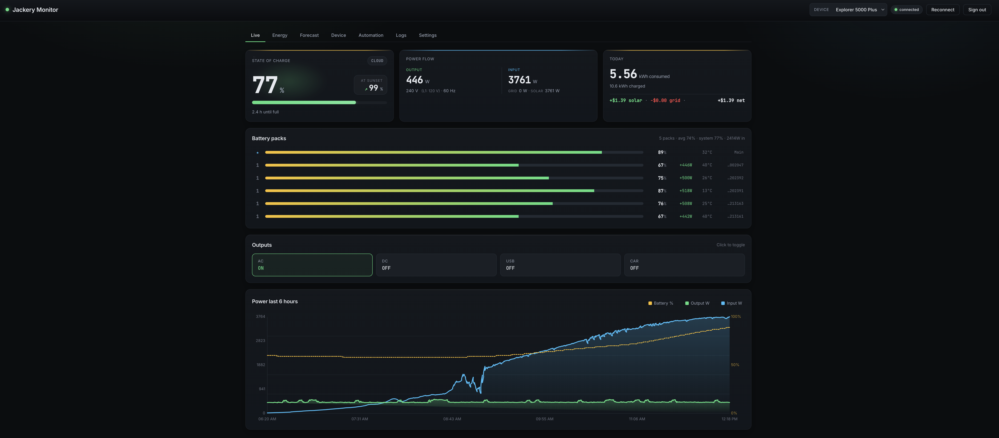

# Jackery Monitor

Last updated: 2026-10-23 11:32 AM CDT.

[](https://github.com/YanivErel-code/jackery-monitor/actions/workflows/ci.yml)
[](https://github.com/YanivErel-code/jackery-monitor/actions/workflows/docker-publish.yml)
[](https://github.com/YanivErel-code/jackery-monitor/releases/latest)
[](LICENSE)
[](https://www.python.org/)

Self-hosted dashboard for Jackery power stations. Live per-battery state +
power flow, 6-hour history chart, output control over MQTT, energy
aggregation in SQLite, **5-day solar SOC forecast**, **smart-charge
automation that turns on a grid-power Kasa plug only when the forecast
says you won't make it through the night**, and **an optional Anthropic or
OpenAI advisor that reviews predictions and telemetry on demand and suggests
config changes for you to approve**.

See the [v1.0.0 release and upgrade guide](docs/releases/v1.0.0.md) for the
major-release overview, changed LG availability policy and known limitations.

Designed to run on a Synology NAS in Docker. Works anywhere with Docker
Compose. Multi-device — handles multiple Jackery devices on the same account
(e.g. Explorer 5000 Plus with up to 5 expansion packs + HomePower 3000) and
per-device automation rules and AI insights. **Each browser picks which
Jackery it's viewing independently** (per-browser cookie), so the phone and
the laptop can look at different units at the same time without stomping
each other.

It connects through the **Jackery cloud account** (the same one the official app uses). On first launch the dashboard prompts you to sign in; credentials are encrypted on disk (AES-256-GCM on Linux/Synology, macOS Keychain on Mac) and never leave your host.

**Jackery Home / HomePower 2000 Ultra (EU):** choose **Jackery Home** in
sign-in for system discovery and read-only monitoring. System SOC/capacity and
named Home power fields are supported; portable controls, energy calculations
and charging automation are unavailable. This path has fixture coverage and
still needs reporter hardware validation. See [Home monitoring](docs/jackery-home.md).



*Live tab: state of charge with sunset SOC prediction, today's kWh + solar/grid dollar breakdown, animated power flow diagram (Solar → Battery → Loads with traveling-dot animation, speed proportional to wattage), output toggles + AC-charge plug control, collapsible per-pack SOC card, and the 6-hour battery + power chart.*

> **🤖 Optional AI advisor.** Choose Anthropic or OpenAI in Settings, then run a review from Automation → Insights. The advisor can inspect forecast errors, smart-charge decisions, samples and weather and propose config changes for your approval. Nothing applies automatically. See [AI features](#ai-features-optional) below.

---

## What's in it

- **Live tab** — hero battery card with mood-aware glow (green when
  charging, blue when discharging, red when low), today's KPIs with
  solar / grid / net savings breakdown, **Tesla-style animated power
  flow diagram** (Solar / Grid → Battery → Loads with travelling
  dots whose speed encodes wattage), 6-hour chart with smooth-bezier
  fills + dual-axis battery %, hover tooltip.
- **Output + grid control** — one toggle row covers all five power
  paths: AC, DC, USB, Car output ports plus the AC-charge Kasa plug
  (the latter only renders when configured for the active device).
  Outputs go over Jackery cloud MQTT (`emqx.jackeryapp.com`), AC-charge
  goes via direct LAN call to the Kasa plug. Backend retries transient
  failures up to 3× before surfacing an error; UI re-syncs to actual
  plug state on failure (no more stuck "err" labels).
- **Energy tab** — today / 7d / 30d / lifetime kWh totals, time-bucketed
  history chart with 6h / 24h / 7d / 30d ranges, per-device totals.
- **Device tab** — model, serial, cloud connection state, last update time.
  "Pause polling" with duration picker so you can hand the cloud session to
  the phone app without the bridge stealing it back.
  **AC auto recovery → Keep AC output on** is saved per device: on by
  default for the Explorer 5000 Plus (model codes 13/22), off for other
  models. Turn it off to leave AC off indefinitely. With recovery enabled,
  a manual AC-off command pauses recovery for 60 seconds; pending recovery
  cycles also honor this pause and changes to the device's recovery setting.
- **Forecast tab** — 5-day hourly SOC simulation. Solar regression fitted
  from your own observed solar-vs-GHI pairs (Open-Meteo); load model uses
  per-hour-of-day medians with a runaway-bucket cap so a single high-output
  event doesn't dominate. Predicted-vs-actual chart accumulates over time.
  **Sunset / sunrise accuracy** keeps the first ready sunrise prediction
  made within 15 minutes after the forecast's sunset boundary immutable,
  alongside the latest rolling estimate. Saved time and original sunrise
  target are visible; sunrise MAE uses only these original snapshots,
  not near-sunrise revisions. Nights stay grouped by their sunset date
  through midnight. The background recorder checks for missing sunset
  snapshots every five minutes even with smart charge off and the tab closed;
  otherwise it builds hourly. Sunrise actuals are finalized after the saved
  target's ±30-minute telemetry window, using capacity-weighted system SOC.
  A moved sunrise target does not change the original evaluation horizon.
  **Not captured** means no ready forecast was available in the sunset
  window (or the row predates this feature); such nights are excluded from
  sunrise accuracy rather than reconstructing an unreliable original.
  Older rolling values remain available. Displayed timestamps use the
  browser's time zone. No forecast-model or charging-control logic changes.
- **Battery packs card** (5000 Plus + expansions) — per-pack SOC,
  input W, temp. Real-time updates over MQTT (no polling).
  Auto-detected total capacity = main + N × expansion. Collapsed by
  default with the summary line always visible (`5 packs · avg 76%
  · system 76% · 237W in`); click the header to drill in. Hidden
  cleanly on no-pack devices.
- **Smart charge** (per-device, in Automation tab) — every 5
  minutes, runs a counterfactual forecast (what would SOC do without
  any AC charging?). Validates the full proposed SOC path, protecting a
  configurable **minimum system SOC reserve (default 10%)** before choosing
  lower-cost windows. Simulates actual ON intervals, concurrent loads,
  partial hours, efficiency, calibrated drain and charge ceilings; a baseline
  clamped at 0% no longer hides remaining overnight energy demand.
  Prefers finishing one hour before sunrise, using the final hour when needed.
  Shows baseline versus scheduled sunrise SOC, minimum planned SOC and warnings
  when the proposed plan cannot satisfy the reserve or target within its limits.
  Charging power is learned automatically per device, using **1,000 W until
  enough reliable history exists**. The newest stable six-minute charging
  window supplies a median sustained rate, not an hourly average or historic
  peak. Filters reject incomplete/stale readings, solar, isolated spikes and
  high-SOC tapering. Unclassified input requires known local night hours.
  Learning looks back 14 days and refreshes within a minute when requested;
  normal controller replanning is every five minutes. The Automation tab shows
  a read-only estimate and source; old manual charging-rate settings no longer
  override learning. This is a forecast assumption, not a device power command.
  Change **Minimum system SOC reserve** in Automation → Controllers → Smart charge;
  it saves automatically. Both Controllers forms (Smart charge, including LG
  protection/mappings/manual hold, and Excess diversion) auto-save valid settings:
  selections/toggles immediately, numbers after a 500 ms typing pause or on blur.
  Each form shows pending/saving/saved feedback. Invalid values are marked and
  not sent; failed saves keep your draft with a **Retry** button. Stay on the page
  until “Saved automatically” appears; leaving with unconfirmed edits prompts
  a warning. Switching Jackery devices never redirects queued writes to the new
  device. Other Automation sub-tabs and Settings retain their existing Save or
  explicit action buttons; Evaluate and Backtest remain manual actions and wait
  until edited settings are confirmed saved.
  The duration budget counts successful active ON/OFF commands in the 24h cycle
  preceding forecast sunrise, including commands before a process restart.
  It conservatively estimates commanded time, not metered charging time, and
  does not count independent/manual charging. The loop wakes at planned interval
  boundaries as well as every five minutes and on LG/config updates. Scheduling
  uses full-precision SOC, not rounded display values. A recent successful ON
  decision retains its already-active validated interval through its original
  end, capped by the remaining duration budget and current forecast hour. The
  path is still recalculated on every tick; LG/manual holds, changed planning
  settings, stale inputs or a no-grid forecast covering both goals override
  retention. A short restart can recover the interval from persisted decisions;
  history older than ten minutes or lacking validated plug identity is not used.
  See [replanning stability and limits](docs/adr/0007-smart-charge-stability.md).
  Network latency and failures still prevent this from being a hardware safety cutoff.
  LG/manual holds remain higher priority; neither a reserve deficit nor an
  infeasible target overrides them. Targets and duration limits are not silently
  increased. See [scheduler design and limits](docs/adr/0002-reserve-aware-smart-charge.md)
  and [automatic charge-rate learning](docs/adr/0003-automatic-charge-rate.md).
  Missing or stale battery readings skip control instead of
  substituting 50% SOC or a generic battery capacity. Device metadata
  can fall back to the same device's persisted catalog model. All decisions
  are persisted with predicted-vs-actual analytics. **Backtest button** replays the last N days of
  decisions through the current code so behavior changes can be
  validated without waiting for fresh data; supports a `target_override`
  to stress-test the discontinuous-schedule path.
  Active mode warns about enabled battery rules controlling the same plug.
  **Disable them** pauses those rules, refreshes their switches, and confirms
  success; it does not turn the plug on or off.
  Exact decision inputs (SOC and receipt sources, capacity, weather used
  through sunrise, model parameters, and baseline trace) are saved for
  30 days and available in decision details and the advisor's
  `query_decision_inputs` tool. Older decisions remain in history with
  unknown original inputs. Snapshots omit credentials and location coordinates.
  New snapshots also preserve exact planned intervals, remaining duration budget,
  and the schedule's reserve/target projection. Legacy snapshots without interval
  durations remain readable but cannot authorize live charging decisions.
- **AI advisor** (optional, daily Claude Opus) — diagnoses the residual
  errors in your forecast and smart-charge tracking, proposes config
  tweaks bounded to a safe whitelist, surfaces anomalies. Human approves
  each suggestion via one-click Apply / Dismiss. Audit log of every
  applied change. See [AI features](#ai-features-optional).
- **Decision narration** (optional, Haiku per fired decision) —
  1-2 sentence plain-English explanation of each smart-charge decision,
  attached to the persisted history row.
- **Automation tab** — Kasa smart-plug rules driven by battery SOC.
  Each rule targets a specific Jackery device, fires once per
  threshold crossing, retries automatically on transient failures.
  Plugs are assigned to a specific Jackery so the smart-charge
  picker only shows the relevant ones. **Self-healing reachability**:
  a background reconciler probes every saved Kasa plug every 5 min
  with per-device exponential backoff (5/10/20/30 min, capped) on
  failure, persists `last_seen` / `last_error` / `consecutive_failures`,
  and lights up a red dot on the Automation tab when any plug is
  offline so you know to look.
- **Logs tab** — ring buffer of bridge events (login, MQTT pushes, contested
  sessions, automation fires, errors). Filter by level or category.
- **Settings tab** — runtime-tunable poll cadences, low-battery threshold,
  session-contested cooldown.
- **PWA** — install on your phone home screen via Safari → Share → Add to
  Home Screen. Service worker caches the UI shell.
- **Auth** — single-user username/password login on first boot. Optional;
  pair with Cloudflare Access for internet-exposed deployments.
- **Real-time updates** — MQTT subscribe to the device push topic gives you
  ~500ms-fresh telemetry instead of HTTP polling rate.
- **Auto-deploy** — `git push` triggers a Watchtower-driven container update
  on the NAS within a minute or two. No manual restarts.

---

## Forecast calibration safeguards

The original physical drain fit still requires near-full SOC (85% or higher).
Systems that never reach that level can additionally learn an **empirical SOC
drain correction**, rather than pretending their unmeasured losses are known.
This does not validate the BMS or identify individual pack/inverter losses.

- Learn only from complete, uncharged, dark-hour intervals with fresh,
  synchronized main/pack receipts and unchanged pack identity/capacity.
- Reject energy-inconsistent SOC jumps, stale readings, gaps, and pack errors.
- Require at least three independent nights with four-hour evidence inside
  the same SOC range. Overlapping windows and midnight crossings do not
  count as extra nights. Use an upper-quartile baseline plus a half-SOC-point
  endpoint-uncertainty allowance; retain priors if evidence is inconsistent.
- When discharge crosses the fixed SOC-bin edges, additionally allow a pooled
  fallback after **five independent nights** of consistent four-hour evidence
  between 40% and 95% SOC. Bound it to the union of actually observed SOC
  ranges, never bridge missing ranges, and expire each disconnected range
  without recent evidence. Reject a materially higher-drain night even if the
  pooled quartiles would hide it. Specific SOC fits always take precedence;
  the pool cannot bypass their band-exit safeguards.
- Apply the correction only while the **entire projected hour** remains a
  net discharge within its validated range, including weak-solar twilight.
  Outside it, during net solar charging, or when evidence ages out, retain the
  conservative legacy model. Diversion lookahead includes these transitions
  and charge-ceiling curtailment.
- A learned charge ceiling limits new charging; it cannot remove energy
  already present in the measured SOC. Real discharge still lowers SOC, and
  later charging remains subject to the learned ceiling.
- Load learning follows a sustained shift on multiple recent days, not one
  transient load spike. Future/incomplete hours cannot become training data.

Forecasts and saved smart-charge input snapshots expose `drain_calibration`,
including SOC bands, independent-night count, and newest evidence timestamp.
`pack_baseline_w` remains a legacy prior, not a measured per-pack loss.
`pack_baseline_applied_w` is non-null if any projected interval retains that
prior, even when a calibration exists elsewhere. Each interval also reports
`drain_baseline_applied_w`, preserved in smart-charge input snapshots.
Charging targets, power limits, and controller modes are not retuned by this.

Validation on 2026-10-13 uses a read-only NAS extract and as-of-only local replay.
On two uncharged holdout nights, the legacy replay matched the saved predictions:
October 11 improved from 34.7% to 40.4% versus 41.33% actual; October 13 improved
from 35.2% to 40.7% versus 41.79% actual. These are limited replay results, not a
live-performance guarantee. Charging and the October 8 SOC discontinuity
intervals are rejected for calibration; charged outcomes are not used to claim
baseline forecast accuracy. Earlier replays have incomplete lookback and do
not exactly reproduce their saved predictions. Replay is offline validation,
not evidence of live deployment or a reason to retune controller settings.

Self-review covers pack/configuration matching, source freshness, causal
training cutoffs, independent-night counting, band-exit/diversion safety, and
legacy fallback. Strict type checking and Bandit pass for the new calibration
core. Whole touched-file scanning also reports existing parameterized-SQL
false positives, expected container-interface binding, and old exception
handlers; none are introduced by this change. No runtime dependency is added.

The October 15 extension was replayed using only telemetry available at each
saved sunset decision, holding its weather, solar coefficient, load forecast,
efficiency, capacity, and charge ceiling fixed. Original replay reproduced all
seven saved decisions. Across five uncharged nights, the current production
algorithm's replay MAE was 6.73 percentage points; the updated replay was 5.13.
On the two nights after the previous calibration deploy, the predictions moved
from 50.0% to 52.6% versus 56.27% actual, and from 55.3% to 60.7% versus 68.91%.
Two nights with grid input were excluded from those accuracy claims. This is
a partial improvement, not a guarantee: unsupported high-SOC ranges still use
priors, and the latest night's replay still missed by 8.21 points. A present
SOC of 94% also does not require a sunset prediction above 94%: weak late-day
solar can be lower than the expected load. See
[`docs/adr/0002-pooled-discharge-calibration.md`](docs/adr/0002-pooled-discharge-calibration.md).

## Architecture

```
   Browser
     │
     ├──HTTPS── /, /api/*, /static, /login    (FastAPI server)
     └──WS──── /ws  (telemetry broadcast)
                                              ▲
                                              │ JSON over TCP (localhost:8766)
                                              │
   FastAPI server (server.py) ◀──────────────▶ Bridge (bridge.py)
        │                                              │
        ├─── SQLite (/data/energy.db)                  ├──HTTPS── iot.jackeryapp.com   (HTTP API: login, properties)
        ├─── /data/settings.json                       │
        ├─── /data/automation.json                     ├──HTTPS── api.open-meteo.com (weather, no key)
        ├─── /data/smart_charge.json                   │
        ├─── /data/kasa_devices.json                   └──MQTT/TLS── emqx.jackeryapp.com  (push + output commands)
        ├─── /data/kasa-creds.json (encrypted)
        ├─── /data/anthropic-creds.json (encrypted, optional)
        ├─── /data/auth.json (encrypted)
        │
        ├──HTTP── Kasa smart plugs on the LAN  (python-kasa, KLAP/SMART/IOT)
        │
        └──HTTPS── api.anthropic.com  (optional: AI advisor + decision narration)
```

Both server and bridge run as the same image (`ghcr.io/yaniverel-code/jackery-monitor`),
just different `command:`s in compose. The shared `/data` volume holds energy
history, credentials (encrypted), automation rules, and settings.

Live SOC, power and pack readings arrive over WebSocket. HTTP status polling
only takes over when pushes have been stale for six seconds, with one recovery
request at a time. Historical energy/savings aggregates refresh on read-only
background connections and are cached for 30 seconds; a cold Live snapshot
shows telemetry immediately and fills energy totals on a subsequent update.
This cache is only for dashboard displays, not charging or recovery decisions.
Forecast requests share a result briefly per device and run historical reads
outside the HTTP event loop. Hidden Energy views do not poll for history.

Run the dashboard request regressions with
`node --test tests/dashboard*.test.js`; Python regressions run with
`pytest`. Both are included in CI.

---

## Quick start — Synology / Linux

The default `docker-compose.yml` pulls a pre-built image from GitHub
Container Registry — no local build step on the NAS.

1. Install **Container Manager** (Synology Package Center) or Docker Compose v2.
2. Get the project files onto the NAS via File Station: download the
   [latest zip](https://github.com/YanivErel-code/jackery-monitor/archive/refs/heads/main.zip)
   and extract into `/docker/jackery-monitor/`.
3. **Container Manager → Project → Create**:
   - Project name: `jackery-monitor`
   - Path: `/docker/jackery-monitor`
   - Source: "Use existing docker-compose.yml"
4. Click **Next → Done**. Container Manager pulls the image (~30s) and
   starts the services.
5. Open `http://<nas-ip>:8123`.
6. **First visit:** pick a username + password to lock down the dashboard.
7. **Second:** sign into your Jackery cloud account through the dashboard
   modal. Credentials are encrypted at rest.

The default port is `8123`. Set `JACKERY_HTTP_PORT=8000` in `.env` if you
want it elsewhere.

### Updating

The compose file ships with a Watchtower service that polls GHCR every
60s and recreates the labelled containers when a new `:latest` is
published. So `git push` → image rebuild → ~60-90s → NAS is up to date.

To update the **compose file itself** (env, services, ports), copy the
new `docker-compose.yml` to your NAS via File Station and recreate the
project.

## Quick start — macOS dev

Bridge runs on the Mac (uses macOS Keychain for credentials), dashboard
in Docker:

```bash
./run-bridge.sh      # listens on 127.0.0.1:8766
docker compose -f docker-compose.dev.yml --profile mac up
open http://localhost:8000
```

Or in fully-mock mode (no Jackery cloud, synthetic telemetry):

```bash
docker compose -f docker-compose.dev.yml --profile mock up
```

---

## PWA install on phone

Open the dashboard URL in **Safari** (iOS) or **Chrome** (Android) →
**Share / menu → Add to Home Screen**. The app opens full-screen, no
browser chrome, looks like a native app. Service worker caches the UI
shell so it loads instantly even on slow networks.

For internet-accessible install, point Safari at your Cloudflare Tunnel
URL (see Authentication below) and Add to Home Screen there.

---

## Authentication

Two layers, use either or both:

### Cloudflare Access (recommended for public exposure)

Free for up to 50 users, edge-level, battle-tested OIDC stack.
1. Run a Cloudflare Tunnel on your NAS (synology has a one-click app).
2. Add a public hostname pointing at `localhost:8123`.
3. Cloudflare Zero Trust → Access → Applications → Add a Self-hosted app
   pointing at the same hostname.
4. Add an Allow policy listing your authorized email(s).

Visit the public URL → email-OTP login → you're in.

### In-app username/password (built-in)

First visit auto-redirects to `/setup` where you pick a username and
password. From then on, `/login` is required. Sign-out button in the
top bar. Password is hashed with PBKDF2-SHA256, session is an
HMAC-signed cookie (HttpOnly, SameSite=Lax, 30-day TTL).

The two layers compose: Cloudflare Access at the edge plus app login
gives you defense in depth.

---

## Automation

Drive Kasa smart plugs from your battery state of charge.

1. **Automation tab → Kasa account.** Enter your Kasa cloud email +
   password. Required for newer Kasa SMART devices (KP125M, EP25, KP405)
   that use KLAP authentication. Older devices (KP115, HS103) ignore
   credentials gracefully — saving them is safe.
2. **Devices section → + Add device.** Enter the Kasa plug's IP (find
   it in your router's DHCP table or the official Kasa app). Click
   **Test** to verify reachability and auto-fill the alias. Save.
   Repeat for every plug you want to control.
3. **Battery-driven rules → + New rule.** Pick a Jackery device,
   threshold (`<`, `<=`, `=`, `>=`, `>` and a percentage), action
   (`on` or `off`), and one of your saved Kasa devices. Save.

Rules are **edge-triggered**: a `<20%` rule fires once when SOC drops
through 20%, not every poll while it's below 20%. It won't fire again
until SOC goes back above 20% and drops below it again. Failed actions
retry on the next poll cycle (transient errors don't burn the trigger).

The bridge polls **all** Jackery devices on the account every cycle, so
a rule targeting your HomePower 3000 fires even while the dashboard is
viewing the 5000 Plus.

---

## LG ThinQ appliance protection (optional)

Last updated: 2026-10-23.

1. In **Settings → General → LG ThinQ**, enter your LG personal access token
   and account country. Create the token at <https://connect-pat.lgthinq.com/>
   with device-list and device-status **read** permissions; appliance-control
   permissions are not needed. Connection is checked before replacing a saved token.
2. Under **Automation → Smart grid charging → LG appliance 220/240 V protection**,
   select the LG appliances **actually connected to the currently selected
   Jackery's 220/240 V output**. Selections save automatically for that Jackery.
   No appliance is selected automatically, and voltage/wiring is never inferred
   from the device type. Unselected appliances do not affect charging.
3. Enable protection; it saves automatically. Confirm “Saved automatically” before
   relying on the change. Any fresh, valid LG power/cycle value other than an
   explicit `OFF` / `POWER_OFF` keeps a selected appliance's 240 V reservation
   and holds that Jackery's charging plug **OFF**. The UI shows **ON (not confirmed
   OFF)** alongside LG's reported phase. Cycle names are not an allowlist:
   `END`, future phases and manufacturer-specific names do not cause monitoring
   warnings or release the hold. Only an explicit OFF reading or the fresh
   disconnected assumption below releases it while monitoring remains available.
   Manual 240 V reservations also hold charging OFF regardless of LG availability.
   Missing tokens, API errors, stale/malformed status, missing devices and empty
   selections instead show a warning and do not block charging.

Device discovery refreshes every five minutes separately from 30-second status
polling. **Settings → General → LG ThinQ → Refresh** re-discovers immediately.
Removed appliances disappear from discovery; a previously selected missing
mapping stays visible as unavailable until you uncheck it.

For appliances whose Wi-Fi shuts down with their power, a fresh LG
device-disconnected response is treated as **assumed OFF**, not proof of power
state. The UI shows “offline — treated as OFF” and decision inputs record that
assumption. A genuine appliance Wi-Fi outage can therefore allow grid charging
while an appliance is running. This exception applies only to the device-status
endpoint's explicit `1222` response. Other failures stay **unknown**, not OFF:
token/permission errors, timeouts, missing devices, device-list failures and stale
cached responses do not block charging under the requested availability policy.
The assumption expires after 75 seconds unless LG reports it again, and every
pre-charge check re-reads the selected appliances as usual.

**Automation shows a persistent LG monitoring warning** for these issues, with
the sanitized cause and a reminder that LG errors do not block charging. The
warning appears above every Automation sub-tab, refreshes with the status poll
and clears automatically after recovery. A separate **red dot on the Automation
tab** alerts you from other tabs; the dashboard reads monitoring status on
startup and every ten seconds while visible, without additional LG cloud calls.
Browser/API request failures also show a warning. Replace an invalid/expired
token in **Settings → General → LG ThinQ**.
Decision inputs record monitoring warnings separately from actual charging holds.
A monitoring outage can allow grid charging while an appliance is running;
use the manual reservation when uninterrupted 240 V availability is required.

This supports generic LG appliances, not just dryers. Missing or malformed
power/status fields remain unknown; a valid new phase name is not a monitoring
failure. No appliance power draw or physical running state is inferred from its name.
For powered-on devices with observed countdown progress, smart charging excludes
windows before the **latest selected appliance's estimated finish plus five
minutes**, including eligible partial hours without starting before that bound. It also
estimates SOC at that finish using the existing no-charging forecast and records
the timing inputs with the decision. This is not extra appliance-wattage learning:
LG power draw is not invented or double-counted on top of the household load.
Every powered-on compartment must have a valid, recently decreasing countdown.
No finish is assumed on the first reading, after an increase/reset, a stale gap,
or when progress has not been seen for 120 seconds. A phase change with an unchanged
countdown also waits for new progress. This detects stalled/paused timers without
recognizing phase names. Countdown progress is only evidence for an estimate,
not proof that an appliance will finish; the hold remains until OFF/disconnected.
Untimed/unconfirmed countdowns and manual holds have no assumed release time.
Unavailable/unknown appliances do not contribute a fictitious finish estimate
or prevent planning around other appliances' confirmed running timers.
An elapsed timer alone never releases a fresh active-state interlock; losing
LG status instead releases the automatic hold with a monitoring warning.
Reported state/timer changes wake the smart charger to recalculate immediately
after the next LG poll rather than waiting for its normal five-minute tick.
Every protected plug ON attempt also performs a fresh cloud status read. A
fresh active state blocks that attempt and wakes another calculation; a read
failure warns without blocking. Manual reservations are always rechecked too.
All discovered LG appliances are polled every 30 seconds, including appliances
not mapped to a Jackery, so their displayed offline-as-OFF status stays current.
Only mapped appliances affect charging protection or wake charging recalculation.
Cached responses expire after 75 seconds. A separate five-second worker enforces
OFF without depending on the forecast, SOC freshness or smart-charge decision
loop. The same plug's app-side manual, rescue and automation ON commands are
blocked too. Protection is live even with smart charging in **Off/Test** mode;
it takes priority over low-SOC rescue charging. It never turns the charging plug
ON by itself.

Before starting a new 240 V appliance, enable **Reserve 240 V availability
(manual hold)**, save, and verify that charging is actually OFF. Jackery disables
some 240 V outlets during AC charging, so an appliance might not be able to start
and report activity if charging is already on. This integration cannot discover
physical wiring, control third-party Kasa apps, or guarantee real-time LG cloud
updates (especially on older models): it is a best-effort software guard, **not
a hardware safety interlock**.

The token is stored AES-256-GCM encrypted in `/data/lg-thinq-creds.json` with
mode `0600`, using the existing application key. API responses never return it.
Removing the token does **not** disable configured protection; reconnect or
explicitly disable protection to release that hold. Backups include the encrypted
token and per-Jackery mappings in `smart_charge.json`; keep the encryption key
separately according to the existing backup policy or reconnect LG after restore.

---

## AI features (optional)

Two Claude-powered features. Both are opt-in, gated by an Anthropic API key
saved encrypted in the data volume. Without a key, the rest of the app is
unaffected.

**1. Algorithm advisor (Opus + extended thinking, daily)**

The hard one. Every morning at 8 AM local time, per device, Claude Opus
reviews:
- Forecast accuracy by lead time bucket (last 14d MAE in pp)
- Last 24h hourly samples (SOC, in/out W, solar, AC input)
- Last 24h hourly weather (GHI, cloud cover)
- Last 48h predicted-vs-actual SOC pairs
- Last 7d smart-charge decisions joined to the actual sunrise SOC
- Last 48h independent control history: smart-charge and solar-charge
  decisions, including balance holds, plus automation and rescue firings
- Current per-device smart-charge config
- Current solar-charge mode and balance settings

The advisor can query specific control windows with `query_control_history`
and simultaneous pack readings with `query_battery_pack_history`. Both tools
filter by device and time before limiting results, and report truncation so
the advisor can narrow its query. Pack history keeps every pack in a snapshot
together and includes HTTP/MQTT receipt provenance; receipt freshness does
not establish when the device measured SOC or whether that reading is correct.

Smart-charge test mode records decisions without toggling the grid plug;
independent rescue and automation rules can still charge. Balance holds keep
solar diversion off, including already-off decisions that need no new toggle.
The advisor correlates these records with measured AC input before attributing
forecast misses or recommending changes. It treats unresolved SOC/power
discontinuities separately from model bias and avoids tuning drain from them.

…and proposes specific config tweaks bound to a whitelist of safe
parameters (`target_sunrise_soc_pct`,
`max_on_duration_minutes`). Each suggestion has an old → new value diff,
Claude's reasoning, and a confidence label. **Nothing applies
automatically** — the user clicks Apply or Dismiss. Hard safety floors
are enforced at apply time (e.g. target SOC can never go below 15%).

Anomaly callouts (e.g. *"the unit drew 3 kW between 2-4 AM yesterday —
unusual vs the prior week"*) appear without an Apply button.

Cost: ~$0.20-0.30 per review with Opus. Daily cadence + manual "Run
review now" button.

**Model + thinking effort selectable in the Settings tab** under
the Anthropic API key card:
- **Advisor model** dropdown — populated live from Anthropic's
  `/v1/models` endpoint (cached 5 min) when a key is saved, or a
  static fallback list otherwise. 1M-capable models get a separate
  "(1M context)" entry that toggles the `context-1m` beta header
  on for that call. Pattern matching for "1M-capable" is config-
  driven via `JACKERY_1M_MODEL_PATTERNS` (default `opus`) so
  future models pick up the variant without code changes.
- **Thinking effort** dropdown (low / medium / high) — adaptive
  thinking budget for Opus 4.7+. Higher = the model self-allocates
  more tokens to think before answering.
- **Narrator model** dropdown — pick a fast/cheap model for the
  per-decision rationale (typically the Haiku line).

Both models read at call time so a Settings change applies on the
next tick without a container restart. `JACKERY_ADVISOR_MODEL` env
var still works as an ops-control override.

**2. Decision narration (Haiku, per fired smart-charge decision)**

Each smart-charge decision gets a 1-2 sentence explanation:
*"Your battery will naturally charge to 83% by sunrise from solar alone,
so we're turning the charger off to avoid wasting grid electricity."*
The narration is attached to the persisted history row and shown
inline in the Recent decisions list.

Cost: ~1 Haiku call per fired decision (typically 1-3/day for an
active-mode setup). Pennies per month.

**Enabling:**
1. Get an API key at console.anthropic.com (need to add credit, $5 minimum).
2. **Settings tab → Anthropic API key.** Paste, click Save & test —
   the server validates with a 1-token API call before persisting.
   Stored encrypted at `/data/anthropic-creds.json`. Forget button
   wipes it.
3. **Automation tab → Smart charge → Claude narration toggle** unlocks
   once a key is saved. Toggle it on per-device.
4. **Automation tab → AI insights** is always visible; click Run review
   now to trigger an on-demand review (30-60s for Opus to think + reply).
5. The daily 8 AM tick fires automatically once a key is configured.

**Privacy of the AI features:** the API key never leaves your NAS. Each
review or narration call sends a snapshot of your telemetry +
configuration to Anthropic; no other data is shared. Disable both at
any time by clearing the key on the Settings page.

---

## Configuration

Most knobs live in the **Settings tab**, persisted to
`/data/settings.json`, applied on the next poll cycle (no restart):

| Setting | Default | Range | What it does |
|---|---|---|---|
| Server poll interval | 2 s | 1-300 | Server → bridge → browser cadence. With MQTT push the bridge has ~500ms-fresh data; this is just the WS broadcast rate. |
| Cloud poll interval | 15 s | 5-600 | HTTP poll to the Jackery cloud. Now a backstop since MQTT push handles real-time. |
| Session-contested cooldown | 60 s | 10-600 | After the phone app bumps the bridge off, how long before the bridge tries to reclaim. |
| Low-battery alert threshold | 20 % | 1-99 | Below this, the dashboard shows a low-battery alert banner. |

Env vars (`POLL_INTERVAL_S`, etc.) act as defaults until you save a
value through the UI.

---

## File layout

```
jackery-monitor/
├── server.py                 FastAPI dashboard, WS broadcast, REST API
├── bridge.py                 Cloud + MQTT bridge (separate container)
├── cloud_client.py           Jackery HTTP + MQTT client
├── device_client.py          mock | bridge | (legacy native) backends
├── energy_db.py              SQLite Wh integrator with per-device totals
├── automation.py             Edge-triggered SOC rule engine
├── kasa_client.py            python-kasa wrapper (status / set_state / discover)
├── kasa_devices.py           Saved Kasa-device registry (/data/kasa_devices.json)
├── kasa_creds.py             Encrypted Kasa cloud creds (/data/kasa-creds.json)
├── auth.py                   App-level user auth (PBKDF2 + HMAC sessions)
├── settings.py               Runtime-tunable settings module
├── crypto_util.py            Shared AES-256-GCM helper
│
├── forecaster.py             Solar regression + load profile + SOC simulation
├── weather_client.py         Open-Meteo client (free, keyless)
├── smart_charge.py           Per-device smart-charge planner + config
├── cost.py                   TOU electricity rate plans + savings math
├── claude_advisor.py         Daily Opus + extended-thinking algorithm review
├── claude_narrator.py        Per-decision Haiku narration
├── anthropic_creds.py        Encrypted Anthropic API key (/data/anthropic-creds.json)
│
├── web/
│   ├── index.html            Main dashboard
│   ├── login.html            /login + /setup pages
│   ├── style.css             Single CSS file (no build step)
│   ├── app.js                Single JS file (no build step)
│   ├── manifest.webmanifest  PWA manifest
│   ├── sw.js                 Service worker
│   └── icon.svg              PWA / favicon icon
│
├── docker-compose.yml        Synology / Linux prod (GHCR pull + Watchtower)
├── docker-compose.build.yml  Build locally on the NAS instead of pulling
├── docker-compose.dev.yml    macOS host-bridge + mock profiles
├── Dockerfile
├── requirements.txt
├── .github/workflows/        Builds + publishes ghcr.io image on push
└── deploy-synology.sh        SSH-based one-command updater (optional)
```

Persistent state on the NAS (Docker volume `jackery-data`, mounted at
`/data` in both containers):

```
/data/
├── energy.db                 SQLite — telemetry, forecast trace, AI suggestions
├── settings.json             Runtime settings overrides
├── automation.json           Saved automation rules
├── kasa_devices.json         Saved Kasa-device registry (per-Jackery assigned)
├── kasa-creds.json           Encrypted Kasa cloud account credentials
├── jackery-creds.json        Encrypted Jackery cloud account credentials
├── auth.json                 Encrypted dashboard-login user
├── anthropic-creds.json      Encrypted Anthropic API key (AI features)
├── smart_charge.json         Per-device smart-charge config
├── location.json             Geocoordinates + tz (for weather)
└── .jackery-creds.key        AES-256 at-rest encryption key (mode 0600)
```

---

## Troubleshooting

| Symptom | Fix |
|---|---|
| Dashboard says *bridge unreachable* | `docker compose logs jackery-bridge` — usually a creds issue. Sign in via the dashboard. |
| Phone app keeps signing out when bridge is running | Expected — Jackery allows one session per account. Use the "Pause polling" button on the Device tab to hand the session over for a configurable duration, or wait the 60s contested-cooldown. |
| Output toggle button reverts after click | Normal — the device takes 5-30s to apply. The UI holds the optimistic state during a 30s "pending" window. |
| Kasa device test fails with `Device response did not match our challenge` | Newer Kasa firmware uses KLAP auth. Enter your Kasa cloud email + password in **Automation tab → Kasa account**. Email is case-sensitive. |
| Kasa test fails with `ZoneInfoNotFoundError` | The image needs the `tzdata` Python package. Should be in latest builds — make sure Watchtower has pulled. |
| Live chart shows only 6 minutes after a deploy | Watchtower restarted the container, in-memory chart history was wiped. The chart hydrates from the energy DB on the next poll — give it a minute. |
| Energy DB lost data after a project recreate | Container Manager's "Delete project" can wipe the volume if you don't uncheck "Delete volumes". Always uncheck. |

---

## Privacy

What stays on your NAS:

- All Jackery telemetry history (`/data/energy.db`, SQLite)
- All automation rules and saved Kasa devices (`/data/automation.json`,
  `/data/kasa_devices.json`)
- All saved settings (`/data/settings.json`)
- All credentials, encrypted at rest with AES-256-GCM:
  - Jackery cloud account → `/data/jackery-creds.json`
  - Kasa cloud account → `/data/kasa-creds.json`
  - Dashboard login → `/data/auth.json`
  - Anthropic API key (AI features) → `/data/anthropic-creds.json`
- The single AES key for all of the above → `/data/.jackery-creds.key`
  (mode 0600)
- All AI suggestions + audit log of applied changes (`/data/energy.db`)

What leaves the NAS:

- Calls to **`iot.jackeryapp.com`** (Jackery cloud) for telemetry + login.
- Calls to **`emqx.jackeryapp.com`** (Jackery cloud MQTT broker) for
  output control + real-time push.
- Calls to **Kasa smart plugs on your LAN** (direct IP) for automation
  actions; for newer Kasa SMART devices, this includes their cloud-account
  credentials in the local KLAP handshake.
- Calls to **`api.anthropic.com`** *only when you've saved an API key*:
  - Daily algorithm review: a snapshot of your forecast accuracy +
    last 24h of telemetry + smart-charge config (no PII, no credentials).
  - Per smart-charge decision narration (when narration toggle is on):
    just the action + reasoning + a few SOC numbers.
  - Disable at any time by clearing the API key on the Settings page.
- Calls to **Open-Meteo** (free, keyless weather API) for
  GHI + cloud-cover forecasts. Just your latitude/longitude in the
  query — no account, no key, no other data.

What is **never** sent off-device by this app:

- No analytics, telemetry, or usage data to the project author.
- No error reporting to a third party.
- No phone-home of any kind. The container speaks to Jackery's cloud
  (because it has to to read your battery state) and to Kasa devices
  on your LAN (because that's the point of the automation feature).
  That's it.

## Adding a new Jackery model

The model_code → battery capacity catalog lives in [`models.json`](models.json) at the repo root. If your device's model_code isn't listed, the forecaster falls back to a conservative 3024 Wh default.

To check your device's model_code:
1. **Device tab → Show raw cloud properties** — look for `_dev_modelCode` in the dump.
2. Or check `Logs tab → /api/devices` debug query — shows `model_code` per device.

To add a new model:
1. Find your model_code via the steps above.
2. Look up the official capacity for your unit (Jackery's spec sheet).
3. PR an entry to `models.json`:
   ```json
   "42": {
     "capacity_wh": 2042,
     "name": "Explorer 2000 Pro",
     "comment": "Confirmed on firmware vX.Y"
   }
   ```
4. Until your PR lands, you can also use **Device tab → Capacity override** for a per-device-only override that takes priority over the catalog.

## Limitations

SOC diagnostics preserve **receipt time** separately from monitor observation
time. These are times the bridge received Jackery's MQTT push or HTTP response;
the cloud does not provide a verified hardware measurement timestamp. Fresh
power messages do not advance the main SOC's receipt time. Expansion-pack
caches expire after two minutes and fall back to HTTP; automatic failed refreshes
retry at most every 30 seconds and retain their original timestamp with `stale=true`.
Repeated cached packets are not persisted as new pack snapshots.

For investigations, `samples.last_source_ts`, `last_soc_source_ts`, and
`last_soc_source` preserve main telemetry/SOC provenance. Pack snapshots retain
`source_ts` and `source` alongside the existing observation `ts`. The packs API
and WebSocket expose receipt time, age, source, and stale status. Historical
rows have NULL provenance because their source times cannot be reconstructed.
Advisor sample queries expose SOC receipt-time ranges for each aggregate bucket.
These fields diagnose delivery delays; they cannot prove battery calibration
or physical energy loss without device-side measurements.

The bridge also watches for **frozen measurements despite successful HTTP
replies**. For known portable models, unchanged main SOC/input/output and all
known expansion-pack SOCs become suspect only after at least 30 minutes of
continuous observations and reported net discharge exceeding 2% of the
catalog system capacity. Idle or charging plateaus do not trigger it. Missing
pack state, invalid readings, and observation gaps do not accumulate evidence.
This is an anomaly heuristic, not proof that the battery or Wi-Fi has failed.

The cloud watchdog then closes the existing HTTP/MQTT client and establishes
a new cloud session without sending battery-output commands. A healthy second
device cannot mask the frozen one. If replies remain unchanged, the warning
persists and retries back off from 30 minutes to at most one per four hours;
HTTP 200 alone never clears it. Intentional pauses and session-contention
cooldowns remain respected. Real measurement progress clears the warning.
The dashboard marks affected readings as an error, and the monitor stops
recording new energy/chart samples, pack snapshots, or generating forecasts and
smart/solar/independent SOC-rule decisions from those suspect values. Existing
plug states are not blindly toggled merely because measurements are suspect.

On confirmation, the monitor also quarantines the detection lead-up: affected
minute readings, pack snapshots, and hour-rounded forecast/actual windows are
removed from active analytics in one transaction. Their original rows remain
in `measurement_quarantine`; persistent `measurement_incidents` record the
device, interval and reason. Invalid sunrise/sunset actuals stay unknown,
not zero or interpolated. Valid earlier sunset forecasts and all controller
audit events remain intact. Totals across a gap represent **partial observed
energy**, not a reconstructed full day. Late writes and actual backfills cannot
silently repopulate an excluded interval. A selective, conflict-checking
`EnergyDB.restore_measurements(device_sn, start_ts)` is available for an
explicitly reviewed rollback; do not replace the live database with an old backup.

Measurement-health evidence is saved atomically next to the cloud credential
file in `measurement-health.json` (mode 0600). Confirmed suspicion and reconnect
backoff survive restarts; unconfirmed observations cannot accumulate through
unobserved gaps. Corrupt state is warned about and remains suspect until
measurement progress, rather than silently reporting a healthy connection.
An explicit account reset clears its evidence.

Per-device `cloud.devices_telemetry[*].measurement_health` reports the unchanged
duration, reported-power discharge budget, suspicion flag, and recovery attempts.
It also reports `unchanged_since`, the conservative start used for quarantine.
`cloud.frozen_devices` identifies affected devices independently of HTTP receipt
age. At 551 W on a 30,240 Wh system, unchanged readings cross the energy guard
after about 66 minutes, rather than remaining silently "connected" overnight.
Until confirmation, these readings are provisional and can still appear in the
dashboard. This guard is not a general detector for changing-power faults,
charging plateaus, or BMS SOC recalibration; SOC-only discontinuities must not
be used to erase otherwise credible measured power.

- **Per-input solar (HPV vs LPV) isn't in the Jackery cloud API.** Only the
  total solar input (`ip - acip - cip`) is exposed. Confirmed empirically
  on a real device and across multiple independent reverse-engineering
  projects. The Jackery iOS app itself shows just one solar number.
- **One Jackery cloud session per account** — bridge + phone fight over
  it. We auto-cooldown on contests; the manual pause button gives you a
  longer window.
- **Kasa SMART devices need cloud credentials** for local control;
  older Kasa devices don't.
- **The cloud API is reverse-engineered** and could change at any time.
  We've added tolerance for known field-name variations, but a major API
  rev would need code changes.

---

## Credits

Reverse-engineered protocol references:
- [jlopez/socketry](https://github.com/jlopez/socketry) — most thorough APK
  decompilation, includes
  [docs/protocol.md](https://github.com/jlopez/socketry/blob/main/docs/protocol.md)
  with the MQTT topic structure and action IDs.
- [theak/jackery-homeassistant](https://github.com/theak/jackery-homeassistant) —
  HTTP-only HA integration; original reference for the property keys.
- [turmacar/jackery-homeassistant](https://github.com/turmacar/jackery-homeassistant) —
  fork that adds writable switches over MQTT.
- [Hsky16's Qiita writeup](https://qiita.com/Hsky16/items/c163137265a87186ac39) —
  original auth-flow analysis.

This app is unaffiliated with Jackery Inc. or TP-Link / Kasa.
